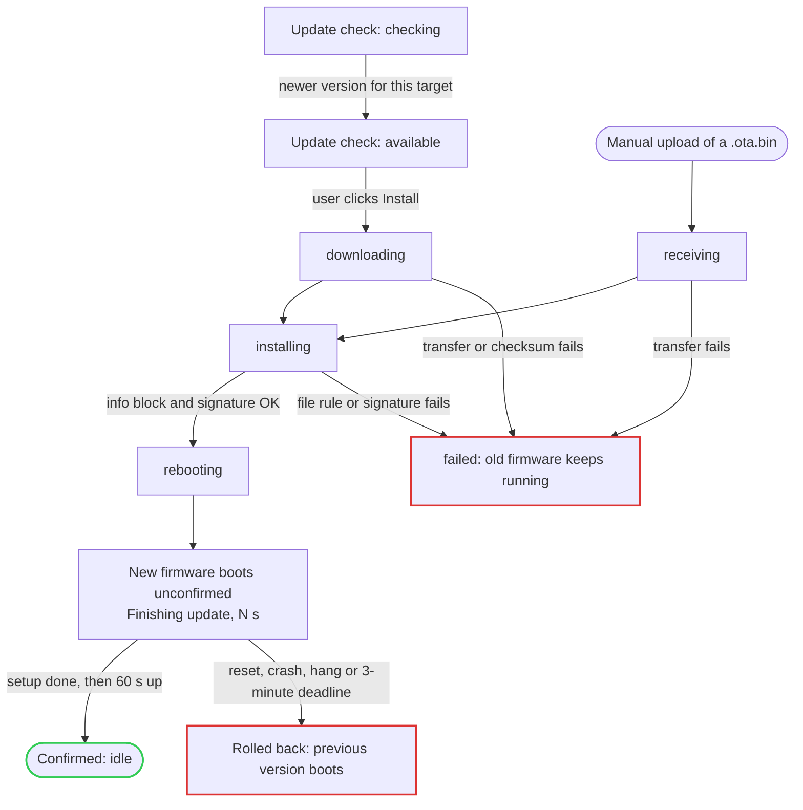

# Architecture

How the firmware is put together: an Arduino sketch in `esp32/` that keeps its settings in NVS, serves an embedded web interface, and updates itself into a second firmware slot.

| File | Role |
| --- | --- |
| `esp32/esp32.ino` | `setup()`/`loop()`: storage, Wi-Fi, mDNS, web server, update manager |
| `ConfigStorage` | Settings and system records in NVS |
| `WiFiManager` | Connects with the saved network, falls back to the access point, connects to new networks |
| `WebServerManager` | Embedded pages and the JSON API ([api.md](api.md)), cross-site protection |
| `UpdateManager` | Uploads, update checks, downloads, rollback and the confirmation window |
| `OtaVerifier`, `OtaKeys.h` | Tries each trusted public key when the core checks a signature |
| `ProjectConfig.h` | Everything a fork changes ([make-it-yours.md](make-it-yours.md)) |
| `BuildInfo.h` | Version, build date, commit and dev-build flag |

## Flash layout

`esp32-4mb` uses `esp32/partitions.csv`:

| Partition | Offset | Size | Holds |
| --- | --- | --- | --- |
| `nvs` | 0x9000 | 20 KB | Settings and system records |
| `otadata` | 0xE000 | 8 KB | Which app slot boots, and whether it is confirmed |
| `app0` | 0x10000 | 0x1F0000 (~1.9 MB) | Firmware slot A |
| `app1` | 0x200000 | 0x1F0000 (~1.9 MB) | Firmware slot B |
| `coredump` | 0x3F0000 | 64 KB | Crash information for debugging |

The bootloader sits at 0x1000 and the partition table at 0x8000. An update writes only the slot that isn't running, so settings survive every update and rollback.

The partition table and bootloader are **frozen from v0.1.0 on**: updates never change them, so a new layout would need a USB flash on every device. `otadata` must stay at 0xE000 and `app0` at 0x10000, which the core's factory-image recipe assumes. The SHA-256 of the table (padded to 0xC00 bytes) is the *layout hash* in every update file; a file for another layout is refused.

## Settings storage

Settings live in NVS through `Preferences`, in two namespaces:

| Namespace | Holds | Factory reset |
| --- | --- | --- |
| `cfg` | `wifi_ssid`, `wifi_password`, `ap_ssid`, `ap_password`, `ap_channel`, `ap_hidden`, `ap_status`, `hostname` | Cleared |
| `sys` | `home_target`, `last_switch`, the pending install (`pend_slot`, `pend_reason`), and a record per slot (`s0_`/`s1_` + `valid`, `version`, `target`, `sha`) | Kept |

- All names are listed once at the top of `ConfigStorage.cpp`.
- Every read takes a default from `ProjectConfig.h`, so a new setting needs no migration.
- An older firmware reads the same names after a rollback, so names are never renamed, reused or given another type (see [CONTRIBUTING.md](../CONTRIBUTING.md#setting-names)). Names are at most 15 characters.
- `WiFi.persistent(false)` stops the Wi-Fi driver keeping its own copy of the credentials. The whole NVS partition is never erased.

**Factory reset** clears `cfg`, calls `esp_wifi_restore()` for anything the Wi-Fi driver kept, and reboots with the defaults. The firmware and the `sys` records stay.

## Build targets

A build target is a configuration the firmware is built for, named `<chip>-<flash>[-<config>]`:

- `<chip>`: an Espressif chip with Wi-Fi: `esp32`, `esp32s2`, `esp32s3`, `esp32c2`, `esp32c3`, `esp32c5`, `esp32c6`, `esp32c61`.
- `<flash>`: `2mb`, `4mb`, `8mb`, `16mb` or `32mb`.
- `<config>` (optional): features, e.g. `relay` or `psram`.
- Lowercase letters, digits and single `-` only; `utils/targets.py check` enforces this in CI.

Each target is made of:

| Piece | File |
| --- | --- |
| Build profile (board, partition scheme, pinned core and libraries) | A profile named after the target in `esp32/sketch.yaml` |
| Partition table | `esp32/partitions.csv` for the default target, `esp32/targets/<target>.partitions.csv` for the others |
| Feature switches | `esp32/targets/<target>.h` |
| Build flags (`-DUPDATE_SIGN`, `OTA_TARGET_ID`, `OTA_TARGET_HEADER`) | `esp32/build_opt.h`, committed for the default target |

To add a target, add those three files; CI builds every profile without workflow changes. Before each build, `python utils/targets.py prepare <target>` copies that target's partition table to `esp32/partitions.csv` and writes its `build_opt.h`, because the Arduino tools only read those from the sketch folder.

The target ID is compiled in. The device never guesses it from the hardware, since two configurations can share the same chip.

## Update states

`UpdateManager` runs every update path (manual upload, pulled download, rollback) through one state machine behind one lock, so only one update runs at a time. A pulled update and a manual upload enter at different states, then share the same checks, reboot and confirmation; every failure ends on firmware that works:

The update check runs 30 s after boot, every 24 h and on request (see [ota-updates.md](ota-updates.md#update-checks)). The states in lowercase are the `state` values of `GET /api/update/status`:

| State | Meaning |
| --- | --- |
| `idle` | Nothing running |
| `receiving` / `downloading` | Writing an uploaded or downloaded file into the inactive slot |
| `installing` | Checking the info block, then the signature (`Update.end()`) |
| `rebooting` | Done; the device restarts from `loop()` after the response is sent |
| `failed` | The last attempt failed; `error` and `message` say why. The running firmware is unchanged |

Update checks have their own state (`never`, `checking`, `up_to_date`, `available`, `no_update`, `needs_manual`, `failed`). Checks and downloads run in background tasks, so the web server stays responsive. The device checks 30 s after boot, then every 24 h plus up to 1 h, and on request. Wi-Fi scan and connect are refused while an update is writing.

An upload that receives no data for 30 s is cancelled with `Update.abort()`. As soon as writing starts, the inactive slot's record is marked invalid.

## Rollback

The core enables the bootloader's one-shot rollback. New firmware boots as **pending**, and if the device resets before the firmware confirms itself, the bootloader marks it invalid and boots the other slot.

- `verifyRollbackLater()` is overridden to return `true`. Otherwise the core would confirm every new firmware before `setup()` even runs.
- **Health check:** once `setup()` has finished (`updateManager.setupDone()`) and the firmware has run 60 s more, it calls `esp_ota_mark_app_valid_cancel_rollback()`. Reaching the home Wi-Fi network is not required.
- **Deadline:** an `esp_timer` rolls back and reboots if the firmware isn't confirmed 3 minutes after boot. The loop watchdog is on while unconfirmed, so a hang also resets and rolls back.
- While unconfirmed, reboot, settings save, factory reset, updates and manual rollback answer `409 "Finishing update, please wait N s"`.

**Slot records** (`sys`): for each slot, whether it holds known-good firmware, its version, target and SHA-256, plus why the last switch happened (`update`, `manual_rollback`, `auto_rollback` or `usb`). On every boot the running firmware's SHA-256 is compared with them:

- An install was pending for the other slot, but this slot is running: the bootloader rolled back. That slot is marked invalid, and the switch is recorded as `auto_rollback`.
- The running firmware matches no record, and no install is pending: it was **flashed over USB**. The records are reset, and its target becomes the **home target**.

**Manual rollback** (`POST /api/update/rollback`) is offered only when the firmware is confirmed, the last switch was `update` and the other slot's record is valid. It calls `Update.rollBack()`, records a pending `manual_rollback` and reboots. The older firmware then goes through the same health check.

**Home target:** the configuration the device was USB-flashed with. Updates never change it; when the running target differs, `/api/status` reports `target_mismatch` and the UI warns.

## Generated files

Committed, never edited by hand; CI fails when they are out of date.

| File | Made by | From | Contains |
| --- | --- | --- | --- |
| `esp32/WebAssets.h` | `utils/build_assets.py` | `web-interface/` | Every page, script and style, minified and gzipped, with its URL, MIME type and content hash (the ETag) |
| `esp32/Version.h` | `utils/build_assets.py` | `VERSION` | `FIRMWARE_VERSION` and its parts |
| `esp32/OtaPublicKey.h` | `utils/keygen.py` | Public keys | The trusted release keys |
| `esp32/OtaPublicKey.local.h` (gitignored) | `utils/keygen.py --dev` | Dev key | Makes a build a dev build |

`build_assets.py` output is byte-identical on every machine:

- gzip uses the pinned `zopfli`, with no timestamp or file name;
- JavaScript is minified with `rjsmin`, HTML and CSS with `css-html-js-minify`;
- all versions are pinned in `utils/requirements.txt`;
- `{{VERSION}}` in the HTML is replaced from `VERSION`.

The commit hash is never in a committed file: release builds get it from CI's `build_opt.h`, and local builds show `dev`.

The web server serves each file with `Content-Encoding: gzip`, its content hash as `ETag` and `Cache-Control: no-cache`. It answers `304 Not Modified` itself when `If-None-Match` matches, so browsers revalidate on each visit and never run stale JavaScript after an update.
